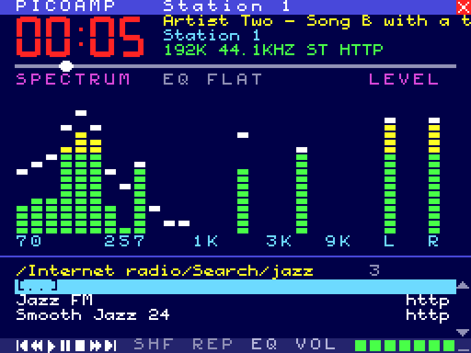
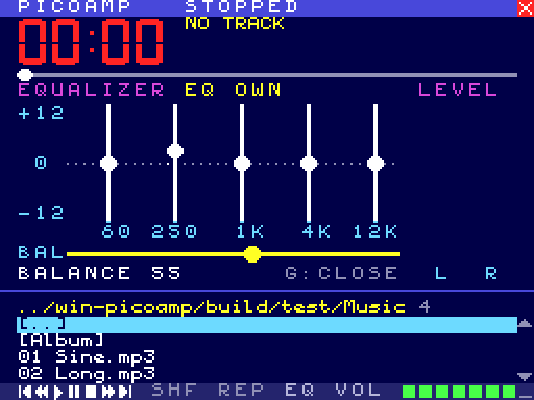
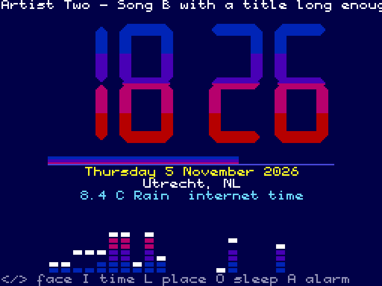
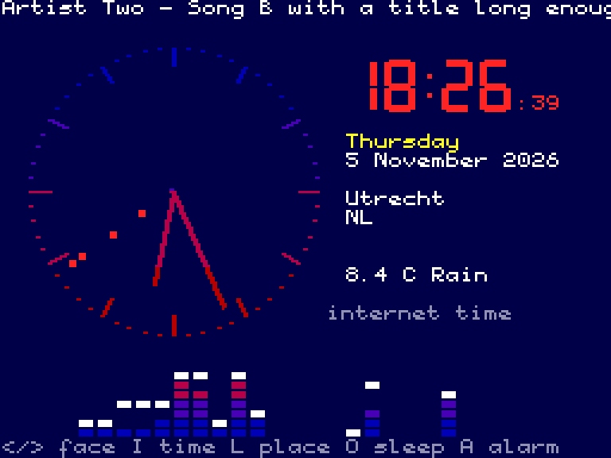
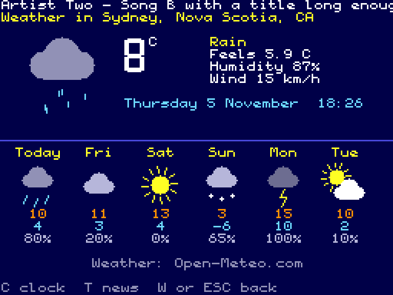
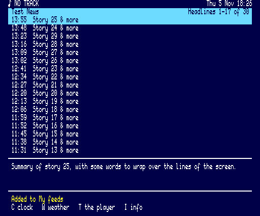
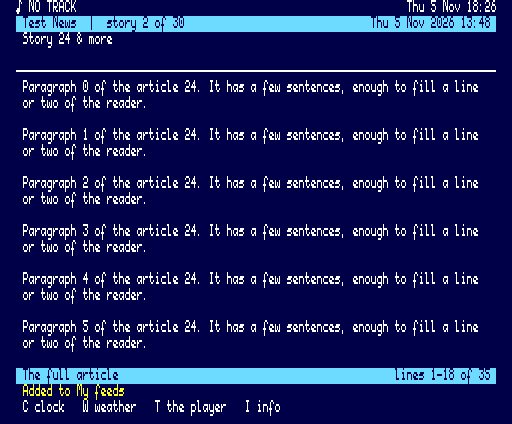
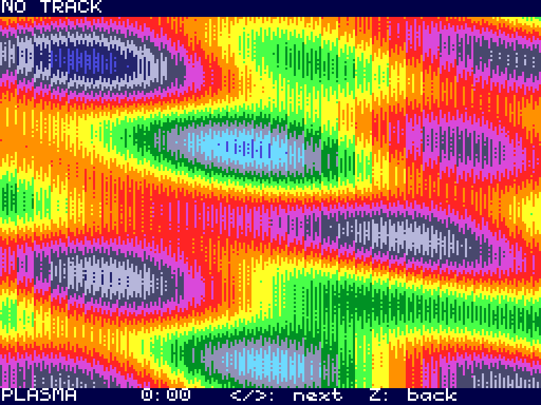

# PicoAmp for Windows

[PICOAMP](https://github.com/Jzzy-dev/msx-picoplay-picoamp), the MSX2 music and internet radio player
for the PicoVerse 2350 cartridge, on a modern Windows PC. Every page is drawn cell for cell as on the MSX,
with the same colours, font, keys and behaviour. It uses the PC's own sound card and internet connection,
and the window can be any size.

| Playing | Internet radio: search | Equalizer (G) |
|---|---|---|
|  |  |  |
| **Clock (C)** | **Clock: analog** | **Weather (W)** |
|  |  |  |
| **News (T)** | **A story** | **Full screen (Z)** |
|  |  |  |

*(The screenshots come from the test build, with its test music, stations, places and feeds.)*

## What it does

* **Music files:** MP3, WAV and FLAC from any folder of the PC, with the title and artist from their
  ID3 tags. The folder is the playlist, with next, previous, shuffle, repeat and ±10 s.
* **Internet radio:** MP3, AAC and HE-AAC (AAC+) streams over HTTP and HTTPS. AAC is decoded by
  Windows itself (Media Foundation) and TLS uses Windows' own certificates.
  * Song titles come from the stream (ICY); `.pls` and `.m3u` links and redirects are followed.
  * Ogg and HLS streams are not supported; PicoAmp says so.
* **The station directory:** Internet radio has Top stations, Most voted, Trending now, By country,
  By genre and By decade, from the free [Radio Browser](https://www.radio-browser.info) directory.
  * Lists load in the background, 60 stations at a time, with "More stations...".
  * `/` or `J` searches it by name.
* **The picture:** a 24-band spectrum analyser with falling peaks, VU meters and an oscilloscope (V).
  * **G** opens the equalizer: five sliders (60 Hz to 12 kHz, ±12 dB) and the balance. Use the keys or
    drag the knobs with the mouse.
  * **E** steps through the presets.
  * **Z** shows the full-screen pictures: Bars, Mirror and Plasma.
  * The analyser and equalizer are the PicoVerse Audio Engine's own code, so the bars move as on the MSX.
* **Clock (C):** digital or analog.
  * Shows the date, the place and the weather now.
  * Its colours turn round a colour wheel with the music (X: or one colour).
  * The place comes from the internet connection or is found by name (L).
  * **O** sets a sleep timer, which fades the music out.
  * **A** sets an alarm (daily or Monday to Friday). It plays what played when it was set and fades in
    over a minute. The alarm only rings while PicoAmp is running (minimised is fine).
* **Weather (W):** a big moving picture of the weather now and the next six days, from
  [Open-Meteo](https://open-meteo.com).
* **News (T):** an RSS/Atom reader in the MSX2's 80-column text mode.
  * Shows the headlines, a story and its **full article**. The article is the feed's own text, or the
    paragraphs of the story's web page without menus and footers.
  * My feeds sit beside a catalogue of 111 feeds in 11 topics.
  * **A** adds any feed by its address.
* **Any window size:** the picture is MSX2 SCREEN 4 (256 × 192), or 512 × 212 for the news text mode.
  * By default it is scaled to fit at 4:3 and stays sharp. It is first enlarged by whole pixels and only
    the last step is smoothed, so every MSX pixel is an even, crisp block.
  * F2 switches to whole multiples only or to stretching; F3 adds scan lines; F11 (or Alt+Enter) goes
    full screen.
* **Your own lists:**
  * Every `.m3u` or `.pls` file in `%APPDATA%\PicoAmp\Radio` is a list of its own under Internet radio.
    Edit them in any text editor; O opens the folder.
  * F adds the chosen or playing station to Favourites, D removes it, and Ctrl+Up/Down moves it.
  * My feeds is `MyFeeds.opml`, the standard format other feed readers import and export.
  * Dropping an `.m3u`/`.pls` (stations) or `.opml` (feeds) file on the window adds it.
* **Windows:**
  * Media keys (play/pause, stop, next, previous) work even when PicoAmp is in the background.
  * Music files dropped on the window, or given on the command line ("Open with"), are played.
  * The window title shows what plays. ESC minimises, and the music plays on.

## Keys

| Key | Player | Key | Player |
|-----|--------|-----|--------|
| Up / Down | Choose | Enter | Open a folder, play a file or a station |
| Left / Right | Page up / down | Backspace | Parent folder |
| Space | Pause / play | S | Stop |
| N / P | Next / previous track | , / . | 10 s back / forward |
| + = / - | Volume | M | Mute |
| H / R | Shuffle / repeat | V | Spectrum / oscilloscope |
| G | Equalizer | E | Next equalizer preset |
| Z | Full screen pictures | / or J | Search the station directory |
| C / W / T | Clock / weather / news | ? | Help |
| F / D | Favourite add / remove | Ctrl+Up/Down | Move a favourite |
| O | Open the station lists' folder | Q | Quit |
| F11, Alt+Enter | Full screen | F2 / F3 / F4 | Scaling / scan lines / always on top |

**Clock:** Left/Right or V switches the face, I the time (the place's zone or the PC's), L the place,
X the colours, B the small spectrum, O the sleep timer, A the alarm.
**News:** Enter reads, 1-9 open a feed, F opens My feeds, S changes the order, N/P the next or previous
story. In My feeds: Enter, D, U/J move, and A adds an address.
**Equalizer:** Left/Right picks a band or the balance, Up/Down changes it, 0 resets it.
The playback keys work on every page.

**Mouse:**
* Click an entry to choose it and click it again to play it. The right button goes back and the wheel
  scrolls.
* The control row, SHF/REP/EQ, the volume cells, the seek bar and the SPECTRUM label can be clicked.
* The equalizer's knobs can be dragged.

## Files

Everything is in `%APPDATA%\PicoAmp` and is plain text, so you can edit it while PicoAmp is closed.

| File | What |
|------|------|
| `picoamp.ini` | The settings: volume, equalizer, balance, the window, scaling, the clock, the place, the alarm, the news order, the folder of the Music entry |
| `Radio\*.m3u, *.pls` | The station lists. `Stations.m3u` is written at the first start; `Favourites.m3u` is kept by F, D and Ctrl+Up/Down |
| `MyFeeds.opml` | My feeds (the news) |

## Building

PicoAmp is plain C (C11). It needs no libraries beyond Windows itself and
[miniaudio](https://miniaud.io), a single header that is included. It builds with MinGW-w64: on Windows
with [MSYS2](https://www.msys2.org) (UCRT64), or as a cross build from Linux with
[llvm-mingw](https://github.com/mstorsjo/llvm-mingw):

```sh
make CROSS=                         # MSYS2 UCRT64: gcc, windres
make                                # Linux with x86_64-w64-mingw32-gcc on the PATH
make test                           # the test build for Linux (no window, null sound) and its checks
```

The result is a single `build/PicoAmp.exe` (about 1.4 MB) that needs nothing else and runs on Windows
10 and 11.
* GitHub Actions builds it on every push and runs it on Windows. The checks cover the drawing, an HTTPS
  station, the real station directory, clock, weather and news, and AAC and HE-AAC stations.
* The zip is attached to each run, and to a release for a `v*` tag.
* `make test` runs 44 checks against a local radio server and stand-ins for the web services.
* `PicoAmp.exe --script "key C; wait 5000; page; quit" --log out.txt` drives the real program the same
  way.

| Folder | What |
|--------|------|
| `src/gfx.c` | The MSX2 picture: cells, 6-pixel text, big digits, the palette (which pages may change) |
| `src/ui.c` | The player screen, the equalizer, the keys, the pages (from `picoamp.asm`) |
| `src/fullscreen.c`, `clock.c`, `weather.c`, `news.c` | The other pages (from `picoamp.asm`, `clock.asm`, `weather.asm`, `news.asm`) |
| `src/audio.c`, `aacdec.c` | The player: decoding thread, playlist, AAC through Media Foundation, the sound device |
| `src/viz.c`, `eq.c`, `json.c` | The PicoVerse Audio Engine's spectrum analyser, equalizer and JSON reader |
| `src/stream.c`, `net.c` | Internet radio: HTTP over sockets (also for `ICY 200 OK`), HTTPS through WinHTTP |
| `src/radiodir.c`, `wxsvc.c`, `newsfeed.c` | Radio Browser; place, zone and weather; feeds and articles (after the engine) |
| `src/library.c`, `config.c` | The list (folders, station lists, the directory, favourites) and the settings |
| `src/main_win32.c` | The window, scaling, keys, mouse, media keys, drag and drop |
| `src/main_host.c`, `script.c`, `tests/` | The test build, the script runner, the stand-in servers, the checks |
| `tools/` | Generators of the font and digits header and of the icon |

## Credits and licence

By **JZZY & Claude**, 2026, after PICOAMP for the MSX PicoVerse 2350 by **Cristiano Goncalves (The Retro
Hacker)**.
* The font is C-BIOS's (BSD licence, `third_party/cbios/LICENSE`).
* The sound goes through [miniaudio](https://miniaud.io) by David Reid (public domain or MIT-0,
  `third_party/miniaudio/LICENSE`).
* Stations come from [Radio Browser](https://www.radio-browser.info), the weather and places from
  [Open-Meteo](https://open-meteo.com), and the internet connection's place from
  [ip-api.com](https://ip-api.com). All are free for non-commercial use and need no key.

Licensed as the PicoVerse project: [Creative Commons Attribution-NonCommercial-ShareAlike 4.0](LICENSE.txt).
