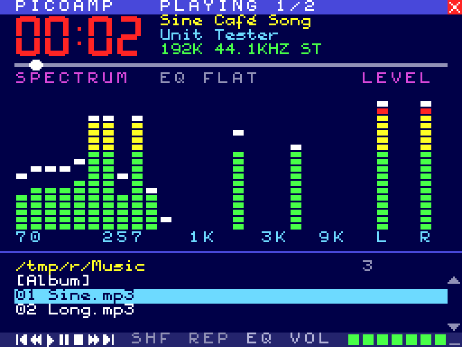
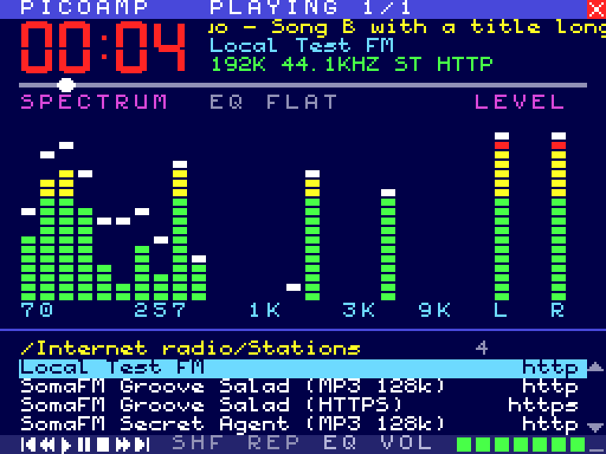
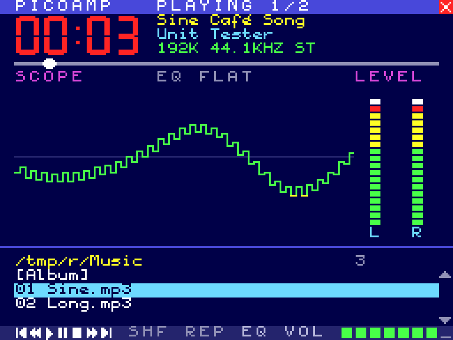

# PicoAmp for Windows

[PICOAMP](https://github.com/Jzzy-dev/msx-picoplay-picoamp), the MSX2 music and internet radio player
for the PicoVerse 2350 cartridge, on a modern Windows PC. It has the same screen, cell for cell, the same
colours, font, keys and behaviour. It uses the PC's own sound card and internet connection, and the window
can be any size.

| Playing | Internet radio | Oscilloscope (V) |
|---|---|---|
|  |  |  |

**Version 0.1** is the main player screen. The equalizer screen (G), the full-screen pictures (Z), the clock (C),
weather (W) and news (T) pages, and the Radio Browser directory with station search are still to come.

## What it does

* **Music files:** MP3, WAV and FLAC from any folder of the PC, with the title and artist from their
  ID3 tags. The folder is the play list (next, previous, shuffle, repeat, ±10 s).
* **Internet radio:** MP3 streams over HTTP and HTTPS (Windows' own TLS and certificates), with the
  song titles from the stream (ICY), `.pls` and `.m3u` links and redirects followed. AAC, Ogg and HLS
  streams are not supported yet; PicoAmp says so.
* **The screen:** a 24-band spectrum analyser with falling peaks, VU meters, an oscilloscope and the
  5-band equalizer presets. The analyser and the equalizer are the PicoVerse Audio Engine's own code, so
  the bars move as on the MSX. Long titles scroll like a ticker; a station shows its name in the title bar.
* **Any window size:** the picture is MSX2 SCREEN 4 (256 × 192). By default it is scaled to fit at 4:3 and
  stays sharp: it is blown up by whole pixels first and only the last step is smoothed, so every MSX pixel
  is an even, crisp block. F2 switches to whole multiples only, or to stretching over the whole window; F3
  turns on scan lines; F11 (or Alt+Enter) gives full screen. The window remembers its size and place.
* **Your own station lists:** every `.m3u` or `.pls` file in `%APPDATA%\PicoAmp\Radio` is a list of
  its own under *Internet radio*. Make as many as you like, name them as you like, and edit them in any text
  editor (O opens the folder). F adds the chosen station (or the one that plays) to *Favourites*, D removes
  it. Dropping an `.m3u` or `.pls` file on the window adds it as a list.
* **Windows:** media keys (play/pause, stop, next, previous) work even when PicoAmp is in the background.
  Music files dropped on the window, or given on the command line ("Open with"), are played. Esc minimises
  the window, and the music plays on (as on the MSX, where Esc returns to MSX-DOS).

## Keys

| Key | Action |
|-----|--------|
| Up / Down | Choose |
| Left / Right, PgUp / PgDn | Page up / down |
| Enter | Open a folder, play a file or a station |
| Backspace | Parent folder |
| Space | Pause / play (a station stops and starts again live) |
| S | Stop |
| N / P | Next / previous track |
| + or = / - | Volume |
| M | Mute (the volume bar turns red) |
| , / . | 10 seconds back / forward |
| H / R | Shuffle / repeat |
| V | Spectrum / oscilloscope |
| E | Next equalizer preset (Flat, Rock, Pop, Jazz, Classic, Voice, Bass, Loud) |
| F / D, Del | Add a station to / remove it from the favourites |
| O | Open the folder of the station lists |
| ? | Help |
| F11, Alt+Enter | Full screen |
| F2 / F3 / F4 | Scaling / scan lines / always on top |
| Esc | Minimise (the music plays on) |
| Q | Quit |

**Mouse:** click an entry to choose it and click it again to play it. The right button goes back and the
wheel scrolls the list. The control row, SHF/REP/EQ, the volume cells, the seek bar and the SPECTRUM label
can be clicked, as on the MSX.

## Files

| Where | What |
|-------|------|
| `%APPDATA%\PicoAmp\picoamp.ini` | The settings (volume, equalizer, shuffle/repeat, the window, scaling, the folder of the *Music* entry). Plain text: edit it while PicoAmp is closed |
| `%APPDATA%\PicoAmp\Radio\*.m3u, *.pls` | The station lists. `Stations.m3u` is written at the first start; `Favourites.m3u` is kept by F and D |

## Building

PicoAmp is plain C (C11) with no libraries beyond Windows itself and [miniaudio](https://miniaud.io)
(a single header, included). It builds with MinGW-w64, on Windows with [MSYS2](https://www.msys2.org)
(UCRT64) or as a cross build from Linux with [llvm-mingw](https://github.com/mstorsjo/llvm-mingw):

```sh
make CROSS=                         # MSYS2 UCRT64: gcc, windres
make                                # Linux with x86_64-w64-mingw32-gcc on the PATH
make test                           # the test build for Linux (no window, null sound) and its checks
```

The result is a single `build/PicoAmp.exe` (about 1.2 MB) that needs nothing else and runs on Windows
10 and 11. GitHub Actions builds it on every push and runs it once on Windows to check the drawing and an
HTTPS station. The zip is attached to the run, and to a release for a `v*` tag.

| Folder | What |
|--------|------|
| `src/gfx.c` | The MSX2 SCREEN 4 picture: cells, the 6-pixel text, the big digits, the palette |
| `src/ui.c` | PICOAMP's screen and keys (from `picoamp.asm`) |
| `src/audio.c` | The player: decoding thread, play list, equalizer, the sound device |
| `src/viz.c`, `src/eq.c` | The PicoVerse Audio Engine's spectrum analyser and equalizer |
| `src/stream.c`, `src/net.c` | Internet radio: HTTP over sockets (also for `ICY 200 OK`), HTTPS through WinHTTP |
| `src/library.c`, `src/config.c` | The list (folders, station lists, favourites) and the settings |
| `src/main_win32.c` | The window, scaling, keys, mouse, media keys, drag and drop |
| `src/main_host.c`, `tests/` | The test build, a small ICY radio server, and the checks |
| `tools/` | Generators of the font and digits header and of the icon |

## Credits and licence

By **JZZY & Claude**, 2026, after PICOAMP for the MSX PicoVerse 2350 by **Cristiano Goncalves (The Retro
Hacker)**. The font is C-BIOS's (BSD licence, `third_party/cbios/LICENSE`); the sound goes through
[miniaudio](https://miniaud.io) by David Reid (public domain or MIT-0, `third_party/miniaudio/LICENSE`).

Licensed as the PicoVerse project: [Creative Commons Attribution-NonCommercial-ShareAlike 4.0](LICENSE.txt).
