# PicoAmp for Windows

[PICOAMP](https://github.com/Jzzy-dev/msx-picoplay-picoamp), the MSX2 music and internet radio player
for the PicoVerse 2350 cartridge, on a modern Windows PC. Every page is drawn cell for cell as on the MSX,
with the same colours, font, keys and behaviour. It uses the PC's own sound card and internet connection,
and the window can be any size.

| Playing | Internet radio: search | Equalizer (G) |
|---|---|---|
| 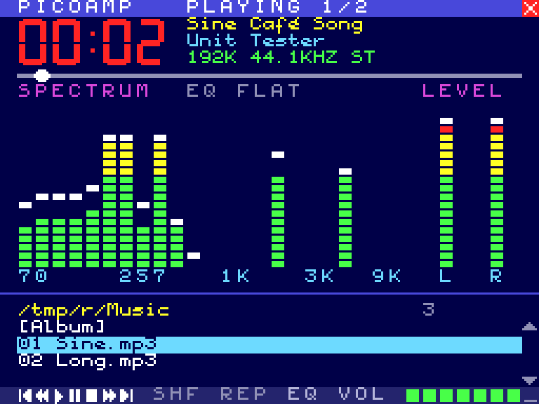 | 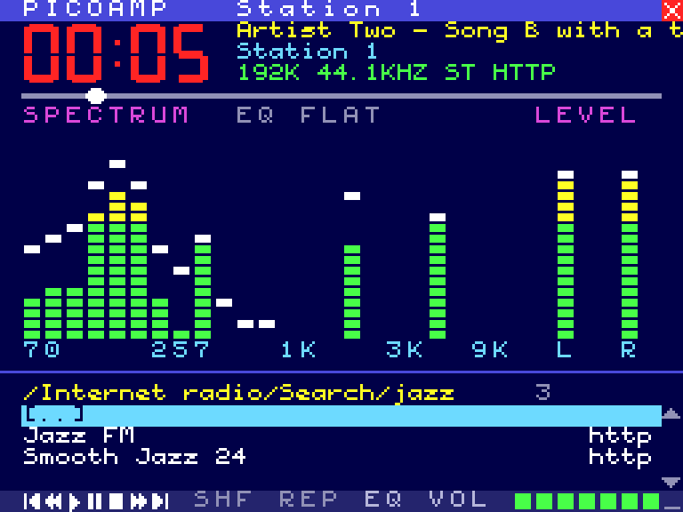 | 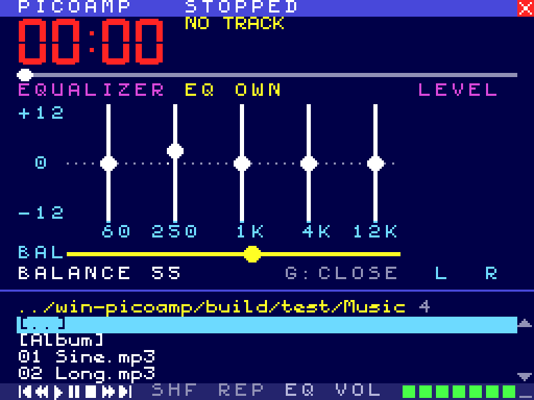 |
| **Clock (C)** | **Clock: analog** | **Weather (W)** |
| 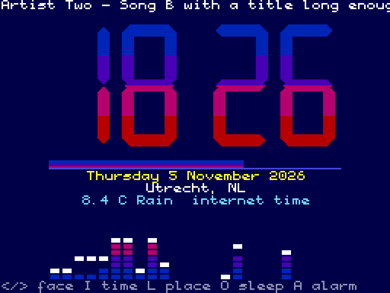 | 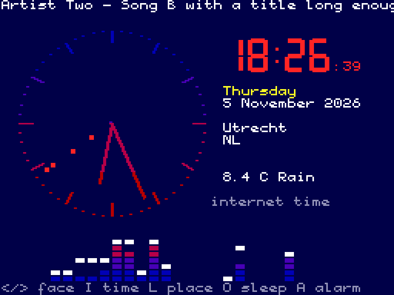 | 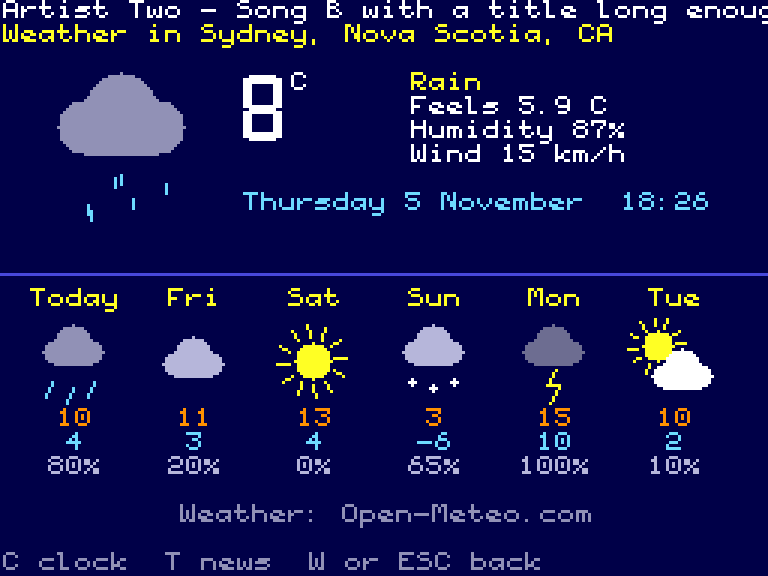 |
| **News (T)** | **A story** | **Full screen (Z)** |
| 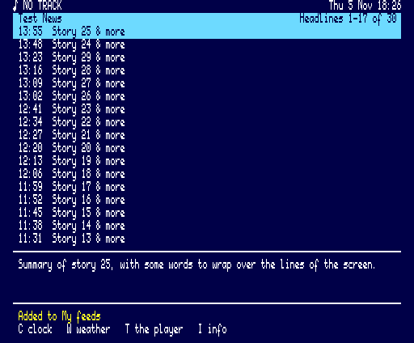 | 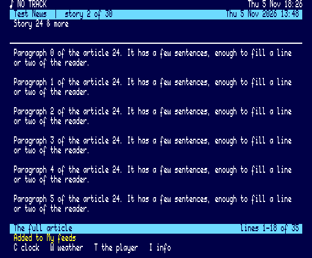 | 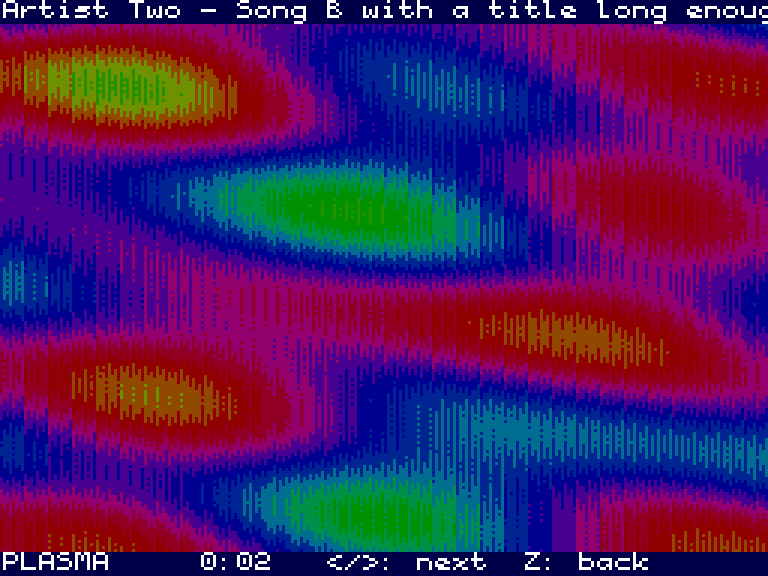 |
| **Pictures (I)** | **A picture** | **The cover big (Z)** |
| 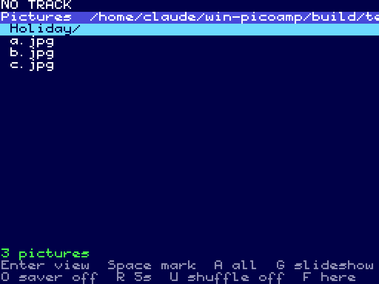 |  |  |
| **Markets ($)** | **A chart: the day** | **A chart: a year** |
| 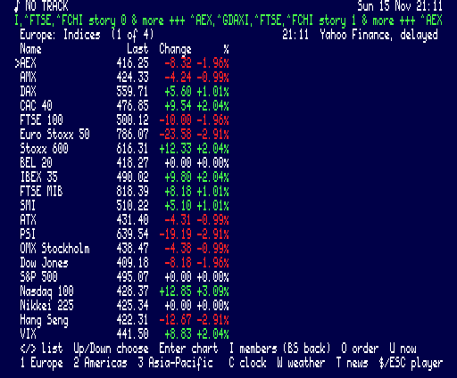 | 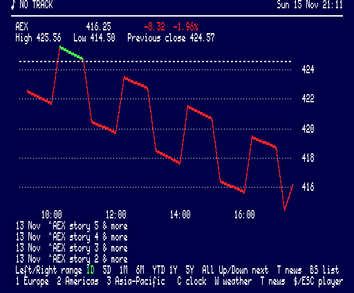 | 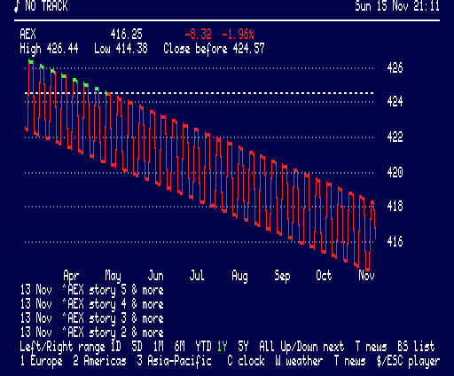 |

*(The screenshots come from the test build, with its test music, stations, places and feeds.)*

## Spotify, other players and Sonos

PicoAmp can be the screen and remote of music it does not play itself, and pass that on:

* **Spotify & other players** (top of the list): what Spotify, the Media Player, VLC (with its
  SMTC plugin), the TIDAL and SoundCloud apps or a browser play, through Windows's own media
  controls. The bars move on that program's sound.
* **Sonos** (top of the list, once speakers answer): a room of the house, through the speakers' own
  control in the network. The sound stays on the speakers.
* Either one shows as PicoAmp's own track: title, artist, album, cover, lyrics (L), and the keys,
  seek bar, shuffle, repeat and volume go to it. Playing a file or a station here takes over.
* **The MSX link (K)** sends it on to PicoAmp on the MSX (its screen and remote, or the sound), and
  it is the bridge that lets [PicoAmp for the web](https://github.com/Jzzy-dev/web-picoamp) reach
  the Sonos rooms. (PicoAmp on the MSX also finds Sonos rooms by itself.)

Details below, under What it does.

## What it does

* **Music files:** MP3, WAV and FLAC from any folder of the PC, with the title and artist from their
  ID3 tags. The folder is the playlist, with next, previous, shuffle, repeat and ±10 s.
* **Internet radio:** MP3, AAC and HE-AAC (AAC+) streams over HTTP and HTTPS. AAC is decoded by
  Windows itself (Media Foundation) and TLS uses Windows' own certificates.
  * Song titles come from the stream (ICY), the song and the artist apart as on the MSX; `.pls` and `.m3u`
    links and redirects are followed.
  * Ogg and HLS streams are not supported; PicoAmp says so.
* **The station directory:** Internet radio has Top stations, Most voted, Trending now, By country,
  By genre and By decade, from the free [Radio Browser](https://www.radio-browser.info) directory.
  * Lists load in the background, 60 stations at a time, with "More stations...".
  * `/` or `J` searches it by name.
* **Spotify (and other players):** **Spotify & other players** at the top of the list makes PicoAmp
  the remote and the screen of what another program plays, through Windows's own media controls (the
  ones of the volume flyout): no account, no key, nothing to sign in to. Spotify is followed when it
  runs, else the program Windows calls the current one (a browser, the Media Player, foobar2000 ...).
  * Its title, artist, album, place in the track and its picture show as PicoAmp's own track: the cover
    view, the full-screen cover (Z), the window's title. A track without a picture gets one from the
    iTunes search, as a file without one does.
  * The bars, the VU meters and the oscilloscope move on its sound: a loopback of the sound card,
    of that program's sound only from Windows 10 build 20348 (Windows 11), else of all of the PC.
  * The keys and the control row go to it: Space / > / || play and pause, N / P (and the media keys) the
    next and previous track, , / . and the seek bar seek, H / R its shuffle and repeat, S pauses it.
  * The volume and mute set the program's own volume in Windows's mixer (Spotify, the Media Player,
    Windows Media Player, Store apps, the browsers (Chrome, Edge, Firefox, Opera, Brave, Vivaldi: for
    SoundCloud, YouTube and the like; the whole browser's volume), apps such as TIDAL and SoundCloud (found by their
    name or package, also when their sound comes from a WebView they started), and programs whose `.exe` Windows names); PicoAmp's own volume is
    kept for its own music.
  * Only programs that tell Windows what they play can be followed. VLC 3 does not (VLC 4 will); the
    [vlc-win10smtc](https://github.com/spmn/vlc-win10smtc) plugin adds it: copy its DLL (the same 32 or
    64 bit as VLC) to VLC's `plugins\misc`, then in VLC's Preferences (All) > Interface > Control
    interfaces tick "Windows 10 SMTC integration" and restart VLC.
  * Playing a file or a station in PicoAmp ends it, and pauses the program if it plays: the new
    music takes over. `PicoAmp.exe --follow` starts with it.
  * Spotify's own app is needed (the desktop or the Store app); its Web API is not used.
* **Sonos:** **Sonos** at the top of the list (it shows once speakers in this network answer) has the
  rooms of the house: Enter on one makes PicoAmp its screen and remote, as for Spotify above. The sound
  stays on the speakers. No account and no key: the speakers' own control in the network (UPnP, port
  1400), as the Sonos apps use it.
  * A room is a group of speakers, named after the one that leads it ("Kitchen + 1"); a pair, a sub or
    surrounds are one room. A room that joins another group is followed to that group.
  * Its song, artist, album, time and cover show as PicoAmp's own track (the cover view, the full-screen
    cover, the lyrics (L), the window's title, the MSX link). A station on the Sonos shows the song it
    plays, with the station's name.
  * The keys go to the room: Space play / pause (a station that cannot pause stops), N / P, `,` / `.` and
    the seek bar, H / R its shuffle and repeat, the volume and mute (the group's, for a group).
  * The bars move on a pretend sound while the room plays, as its sound does not come to this PC
    (`sonos_bars = off` in `[sonos]` of `picoamp.ini`: no bars).
  * Speakers are found with an SSDP search in the network. When a network keeps that from them (some
    mesh WiFi and guest networks), put their addresses in `sonos_ip = ` (a comma between them).
  * Windows asks once whether PicoAmp may use the network: allow private networks.
* **The MSX link (K):** PicoAmp on the MSX ([msx-picoplay-picoamp](https://github.com/Jzzy-dev/msx-picoplay-picoamp)
  v1.6, engine 0.18) shows, controls or plays what this PC plays: Spotify, the Media Player (or another
  player it follows), or PicoAmp's own files and stations. K turns it on and shows the address to put in
  the MSX's favourites (`RADIOFAV.M3U` on its card), e.g. `http://192.168.1.20:8765/screen`; Windows asks
  once whether PicoAmp may take connections (allow private networks). Two ways, two addresses (both in
  `/picoamp.m3u`):
  * `/screen`: the MSX as this PC's **screen and remote**. The sound stays here; the MSX shows the song,
    its time and seek bar, playing or paused, the cover (once it is made here), this PC's format line
    (`SPOTIFY 48.0KHZ`) and the bars as this PC shows them (25 times a second, in step with what you hear
    here). The lyrics go along too: **L** on the MSX shows them, the line sung now lit, as here.
  * `/stream.mp3`: the MSX as a **speaker**: an MP3 stream (160 kbit/s, Windows's own MP3 encoder) of what
    is heard here, an internet radio station to the MSX with the song in its titles; silence while nothing
    plays, so the station stays. The MSX plays a few seconds behind (its buffer): turn this PC's speakers
    down.
  * In both, the MSX's keys come back here (`/cmd`): SPACE, N, P (pause, next, previous), `,` `.` (seeking),
    H and R (shuffle, repeat), the volume keys and M (PicoAmp's volume, or the followed player's), also for
    Spotify.
  * The cover goes to the MSX as it wants it: 80 × 80, baseline JPEG (`/cover.jpg`); for its full screen
    cover (Z) as big as fits 281 × 192 (`/cover.jpg?w=281&h=192`).
  * `/now` says what plays (JSON).
  * `[msx]` in `picoamp.ini`: `msx_link`, `msx_port` (8765), `msx_kbps` (96, 112, 128, 160, 192).
  * **For PicoAmp for the web:** a web page cannot reach Sonos speakers itself, so while K is on, this PC
    answers it for them: `/sonos/rooms`, `/sonos/now?id=`, `/sonos/cmd?id=&c=`, `/sonos/vol?id=&v=&m=`,
    `/sonos/art?id=`. On a phone or a tablet in the same network, open `http://<this PC>:8765/web/`: PicoAmp
    for the web, fetched from its site by this PC, with Sonos through it.
* **Lyrics (L):** the words of what plays, from [LRCLIB](https://lrclib.net), a free, open lyrics
  database (no account, no key). Many songs have synced lyrics: the line sung now shows in yellow,
  the ones sung in grey, the ones to come below. Songs with plain lyrics only scroll through the song,
  or with Up/Down.
  * A file and another program (Spotify ...) are asked by artist, title, album and length, so the
    version is the right one. A station's song (from its title) is asked by artist and title, and is
    timed from when its title is heard. Stations send titles a bit early or late, so `[` and `]` move
    the words half a second, and `0` puts them right again.
  * Tuned in during a song, a station's song has no known time: the page says **ENTER: SYNC** and
    lights no line. Move the line that is sung now onto the band in the middle (Up/Down) and press
    **Enter**: the words follow from there. Enter does that any time the timing is off.
  * What was found is kept in `%APPDATA%\PicoAmp\Lyrics`. When nothing was found, that is kept for
    a week; **R** forgets it and looks again.
  * Not every song is there: well-known songs mostly are, rarer ones and many non-English ones not.
* **The picture:** a 24-band spectrum analyser with falling peaks, VU meters and an oscilloscope (V).
* **The cover (V a third time),** as PICOAMP on the MSX shows it: 80×80 pixels in MSX SCREEN 4 cells
  (two colours in every 8 pixels of a row) with five palette entries of its own for each row of cells
  (as the MSX with engine 0.17; `rows = off` in `picoamp.ini`: five for all of it), 12 bars beside it.
  * It comes from the track's tag (MP3's ID3 picture, the front cover first; FLAC's picture), else from
    an image in its folder: `cover`, `folder`, `front`, `album`, `albumart` or `AlbumArtSmall`, as
    `.jpg`, `.jpeg` or `.png`.
  * A station shows its logo, found as the MSX engine finds it. Radio Browser is asked for the
    station by its directory id, else by its address, else by its exact name. The station's `favicon`
    is fetched and kept in `%APPDATA%\PicoAmp\Logos`, and "no logo" is kept too. The next start shows it
    at once without asking again. Delete the folder to have the logos fetched again.
  * The song that plays on a station ("Artist - Title"), and a file without a picture (by its tags:
    artist and album, else artist and title), get their cover from the iTunes search, kept in
    `%APPDATA%\PicoAmp\Covers`. A song's cover shows over the station's logo; a song without one shows
    the logo again.
  * At most 100 logos and 200 covers are kept (`keeplogos`, `keepcovers` in `picoamp.ini`; 0 keeps all).
    When a folder has more, the ones shown longest ago go, down to 90 %; a copy shown again counts as
    new. "No logo" and "no cover" notes are asked again after 30 days.
  * When nothing has a cover, one of three default pictures shows (Copacabana, New York, Amsterdam), a
    new one at random for each track or station. More: put JPEG or PNG files in `%APPDATA%\PicoAmp\Defaults`.
  * JPEGs go through the same decoder as on the MSX (TJpgDec); PNG and the rest through Windows's own.
  * The conversion is the MSX engine's own file (`src/pva_cover.c`), so it looks the same.
  * **G** opens the equalizer: five sliders (60 Hz to 12 kHz, ±12 dB) and the balance. Use the keys or
    drag the knobs with the mouse.
  * **E** steps through the presets.
  * **Z** shows the full-screen pictures: Bars, Mirror, Plasma and Cover. Cover shows the cover big in
    MSX SCREEN 8 (256 × 192, 256 colours, dithered), as the MSX does: the track's own picture, the
    folder's, the one from the internet (iTunes covers at 600 × 600), the default pictures whole.
  * The analyser and equalizer are the PicoVerse Audio Engine's own code, so the bars move as on the MSX.
* **Pictures (I):** a browser of the PC's folders that shows only folders and pictures (JPEG, PNG, BMP,
  GIF, TIFF, WebP), starting in your Pictures folder.
  * Enter shows one in MSX SCREEN 8 (256 × 192, 256 colours, fitted with the MSX's dot shape and
    dithered); Left/Right the one before or after, Space marks it, any other key goes back.
  * Space marks pictures (A all); **G** plays the marked ones, or all of the folder, as a slideshow.
  * **O** sets the screensaver (off, 1, 2, 5, 10, 15 or 30 minutes), **R** how long a picture shows
    (5 to 60 s), **U** shuffle, **F** makes this folder the screensaver's.
  * The screensaver plays that folder's slideshow after the minutes without a key or a click, while the
    player shows (not on another page); any key goes back. The music plays on.
* **Clock (C):** digital or analog.
  * Shows the date, the place and the weather now.
  * Its colours turn round a colour wheel with the music (X: or one colour).
  * The place comes from the internet connection or is found by name (L).
  * **O** sets a sleep timer, which fades the music out.
  * **A** sets an alarm (daily or Monday to Friday). It plays what played when it was set and fades in
    over a minute. The alarm only rings while PicoAmp is running (minimised is fine).
* **Weather (W):** a big moving picture of the weather now and the next six days, from
  [Open-Meteo](https://open-meteo.com).
* **News (T):** an RSS/Atom reader in the MSX2's 80-column text mode.
  * Shows the headlines, a story and its **full article**. The article is the feed's own text, or the
    paragraphs of the story's web page without menus and footers.
  * My feeds sit beside a catalogue of 111 feeds in 11 topics.
  * **A** adds any feed by its address.
* **Markets ($):** a market monitor after the [IEX Markt Monitor](https://monitor.iex.nl/), as PICOAMP v1.4
  on the MSX has it: 80 columns in four colours (MSX2 SCREEN 6), risers green and fallers red.
  * A list of up to 100 instruments, 40 a page in two columns: name, price, change and percent against the
    previous close. **Left/Right** the list, **1 2 3** the region (Europe, Americas, Asia-Pacific). Each region
    has its indices, a list of currencies, commodities and rates (with their currency: "Gold USD/oz"), and the
    shares of two markets. My list is `list = ` in `[markets]` of `picoamp.ini` (Yahoo Finance symbols).
  * **I** on an index shows its members (15 indices: AEX, AMX, DAX, CAC 40, FTSE 100, Euro Stoxx 50, BEL 20,
    IBEX 35, Dow 30, Nasdaq 100, S&P 100, Bovespa, IPC Mexico, Hang Seng, Nikkei 225's 40 largest); BS back.
    **O** orders a list by percent (risers first, fallers first), **U** updates now.
  * Row 1 is a tape of the region's market headlines (every 15 minutes).
  * **Enter** shows the chosen one's chart: a line with a price scale and a time scale, green above the close
    before the range (the dashed line) and red under it. **Left/Right** the range: 1D, 5D, 1M, 6M, YTD, 1Y, 5Y,
    all years; **Up/Down** the next one. Its four latest headlines are under it; **T** reads them in the news
    reader, where ESC comes back.
  * The prices come from Yahoo Finance's chart service: unofficial, no key, delayed by 15 to 20 minutes
    for most exchanges, and it may change or stop. They are fetched only while the page shows, again every
    minute (`refresh = `). The catalogue is the MSX engine's own (`src/markets_cat.c`).
* **Any window size:** the picture is MSX2 SCREEN 4 (256 × 192), or 512 × 212 for the news text mode.
  * By default it is scaled to fit at 4:3 and stays sharp. It is first enlarged by whole pixels and only
    the last step is smoothed, so every MSX pixel is an even, crisp block.
  * F2 switches to whole multiples only or to stretching; F3 adds scan lines; F11 (or Alt+Enter) goes
    full screen.
  * **F5: sharp covers.** The cover shows in its own resolution (the cover view's square and the full
    screen cover) instead of as the MSX shows it in 8-bit colours; F5 again goes back. It is kept
    (`sharp = ` under `[cover]` in picoamp.ini).
* **Your own lists:**
  * Every `.m3u` or `.pls` file in `%APPDATA%\PicoAmp\Radio` is a list of its own under Internet radio.
    Edit them in any text editor; O opens the folder.
  * F adds the chosen or playing station to Favourites, D removes it, and Ctrl+Up/Down moves it.
  * My feeds is `MyFeeds.opml`, the standard format other feed readers import and export.
  * Dropping an `.m3u`/`.pls` (stations) or `.opml` (feeds) file on the window adds it.
* **Windows:**
  * Media keys (play/pause, stop, next, previous) work even when PicoAmp is in the background.
  * Music files dropped on the window, or given on the command line ("Open with"), are played.
  * The window title shows what plays. ESC minimises, and the music plays on.

## Keys

| Key | Player | Key | Player |
|-----|--------|-----|--------|
| Up / Down | Choose | Enter | Open a folder, play a file or a station |
| Left / Right | Page up / down | Backspace | Parent folder |
| Space | Pause / play | S | Stop |
| N / P | Next / previous track | , / . | 10 s back / forward |
| + = / - | Volume | M | Mute |
| H / R | Shuffle / repeat | V | Spectrum / oscilloscope / cover |
| G | Equalizer | E | Next equalizer preset |
| Z | Full screen pictures | / or J | Search the station directory |
| C / W / T | Clock / weather / news | ? or F1 | Help (also the **?** box in the title bar) |
| L | Lyrics (`[` `]` their timing) | K | The MSX link on / off |
| I | Pictures and slideshow | $ | Markets |
| F / D | Favourite add / remove | Ctrl+Up/Down | Move a favourite |
| O | Open the station lists' folder | Q | Quit |
| F11, Alt+Enter | Full screen | F2 / F3 / F4 / F5 | Scaling / scan lines / always on top / sharp covers |

**Clock:** Left/Right or V switches the face, I the time (the place's zone or the PC's), L the place,
X the colours, B the small spectrum, O the sleep timer, A the alarm.
**News:** Enter reads, 1-9 open a feed, F opens My feeds, S changes the order, N/P the next or previous
story. In My feeds: Enter, D, U/J move, and A adds an address.
**Markets:** Up/Down choose, Left/Right the list, Enter the chart, I an index's members (BS back), O the
order, U update now, 1 2 3 the region. In the chart: Left/Right the range, Up/Down the next one, T its
headlines in the news reader, Enter/BS/ESC the list.
**Lyrics:** Up/Down and the wheel scroll, Home follows the song again, Enter: the line on the middle band
is sung now (synced by hand), `[` / `]` the timing -/+ 0.5 s, `0` puts it right, R looks again, L/Esc back.
**Equalizer:** Left/Right picks a band or the balance, Up/Down changes it, 0 resets it.
**Pictures:** Enter shows a picture or opens a folder, Backspace the folder above (and the drives),
Space marks, A all, G slideshow, O screensaver, R interval, U shuffle, F the screensaver's folder,
Esc or I back.
The playback keys work on every page.

**Mouse:**
* Click an entry to choose it and click it again to play it. The right button goes back and the wheel
  scrolls. Over **VOL** and its bar the wheel sets the volume.
* The **?** box in the title bar opens the help page.
* The control row, SHF/REP/EQ, the volume cells, the seek bar and the SPECTRUM label can be clicked.
* The equalizer's knobs can be dragged.

## The Microsoft Store

A download of `PicoAmp.exe` is not signed, so Windows SmartScreen warns about an unknown publisher (and
some company PCs block it). An app from the Microsoft Store is signed by Microsoft. Every build makes an
MSIX package for the Store; [docs/STORE.md](docs/STORE.md) has the steps for whoever publishes it (free for
individual developers), and the text for the listing. Installed from the Store, PicoAmp keeps its settings
in the package's own folder (`%LOCALAPPDATA%\Packages\<package>\LocalState\PicoAmp`; O opens it).

## Files

Everything is in `%APPDATA%\PicoAmp` and is plain text, so you can edit it while PicoAmp is closed.

| File | What |
|------|------|
| `picoamp.ini` | The settings: volume, equalizer, balance, the window, scaling, the clock, the place, the alarm, the news order, the folder of the Music entry, the cover's colours (`rows`), how many logos and covers are kept (`keeplogos`, `keepcovers`), the pictures (`saver`, `interval`, `pictures_shuffle`, `pictures`: the screensaver's folder) |
| `Radio\*.m3u, *.pls` | The station lists. `Stations.m3u` is written at the first start; `Favourites.m3u` is kept by F, D and Ctrl+Up/Down |
| `MyFeeds.opml` | My feeds (the news) |

## Building

PicoAmp is plain C (C11). It needs no libraries beyond Windows itself and
[miniaudio](https://miniaud.io), a single header that is included. It builds with MinGW-w64: on Windows
with [MSYS2](https://www.msys2.org) (UCRT64), or as a cross build from Linux with
[llvm-mingw](https://github.com/mstorsjo/llvm-mingw):

```sh
make CROSS=                         # MSYS2 UCRT64: gcc, windres
make                                # Linux with x86_64-w64-mingw32-gcc on the PATH
make test                           # the test build for Linux (no window, null sound) and its checks
```

The result is a single `build/PicoAmp.exe` (about 1.4 MB) that needs nothing else and runs on Windows
10 and 11.
* GitHub Actions builds it on every push and runs it on Windows. The checks cover the drawing, an HTTPS
  station, the real station directory, clock, weather and news, and AAC and HE-AAC stations.
* The zip is attached to each run, and to a release for a `v*` tag.
* `make test` runs its checks against a local radio server and stand-ins for the web services.
* `PicoAmp.exe --script "key C; wait 5000; page; quit" --log out.txt` drives the real program the same
  way.

| Folder | What |
|--------|------|
| `src/gfx.c` | The MSX2 picture: cells, 6-pixel text, big digits, the palette (which pages may change) |
| `src/ui.c` | The player screen, the equalizer, the keys, the pages (from `picoamp.asm`) |
| `src/fullscreen.c`, `clock.c`, `weather.c`, `news.c`, `markets.c` | The other pages (from `picoamp.asm`, `clock.asm`, `weather.asm`, `news.asm`, `markets.asm`) |
| `src/mktsvc.c`, `markets_cat.c` | The markets' prices, charts and headline tape from Yahoo Finance in a thread; the catalogue (the MSX engine's `pva_markets_cat.c`) |
| `src/audio.c`, `aacdec.c` | The player: decoding thread, playlist, AAC through Media Foundation, the sound device |
| `src/viz.c`, `eq.c`, `json.c` | The PicoVerse Audio Engine's spectrum analyser, equalizer and JSON reader |
| `src/stream.c`, `net.c` | Internet radio: HTTP over sockets (also for `ICY 200 OK`), HTTPS through WinHTTP |
| `src/radiodir.c`, `wxsvc.c`, `newsfeed.c` | Radio Browser; place, zone and weather; feeds and articles (after the engine) |
| `src/library.c`, `config.c` | The list (folders, station lists, the directory, favourites) and the settings |
| `src/cover.c`, `pva_cover.c`, `third_party/tjpgd` | The cover view: the picture found and decoded; `pva_cover.c` is the MSX engine's own conversion to SCREEN 4 cells |
| `src/logo.c` | A station's logo: Radio Browser's `favicon`, fetched in a thread and kept in `Logos` |
| `src/sonos.c` | Sonos: the search (SSDP), the rooms, a room's song and keys (UPnP/SOAP); `tests/sonos_fake.py` pretends three speakers |
| `src/main_win32.c` | The window, scaling, keys, mouse, media keys, drag and drop |
| `src/main_host.c`, `script.c`, `tests/` | The test build, the script runner, the stand-in servers, the checks |
| `tools/` | Generators of the font and digits header and of the icon |

## Credits and licence

By **JZZY & Claude**, 2026, after PICOAMP for the MSX PicoVerse 2350 by **Cristiano Goncalves (The Retro
Hacker)**.
* The font is C-BIOS's (BSD licence, `third_party/cbios/LICENSE`).
* The sound goes through [miniaudio](https://miniaud.io) by David Reid (public domain or MIT-0,
  `third_party/miniaudio/LICENSE`).
* Stations come from [Radio Browser](https://www.radio-browser.info), the weather and places from
  [Open-Meteo](https://open-meteo.com), and the internet connection's place from
  [ip-api.com](https://ip-api.com). All are free for non-commercial use and need no key.

Licensed as the PicoVerse project: [Creative Commons Attribution-NonCommercial-ShareAlike 4.0](LICENSE.txt).
